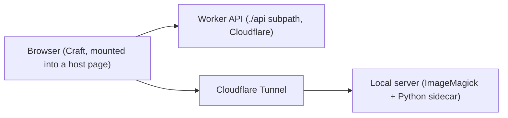

# Contributing

How to run Craft locally, where things live, what checks a change must pass,
and how it reaches production. What it does for a user is in
[features.md](features.md).

Work in a git worktree, not the main checkout, per the repo's own `AGENTS.md`.

## Run it locally

You need Node, pnpm (the version pinned in `package.json`'s
`packageManager`), and, for the local server, ImageMagick plus a Python 3
virtual environment.

```sh
pnpm install
pnpm dev          # starts the local processing server (PM2) + Vite
```

Open the dev server's URL; the two routes are `/` (Print) and `/palette`
(Palette) under Vite, versus `/craft` and `/craft/palette` once this app is
mounted into its parent site (below).

**The local server.** `server/` is a Node server, never published, that wraps
ImageMagick and a Python sidecar (background removal, cutlines) and is meant
to run on a real machine with those tools installed — not a build artifact.
One-time setup:

```sh
cd server
python -m venv .venv
.venv/bin/pip install -e .   # .venv/Scripts/pip on Windows
```

Then `pnpm local:start` (PM2) brings it up; `pnpm local:logs` and
`pnpm local:stop` manage it. Calibration Sheet and Stickers call this server;
without it running, those two modes fail with a message saying so rather
than silently producing nothing. Simple Tiling, Postcard Duplex, Collage and
Palette need no server at all — they run entirely in the browser.

## Architecture



Craft ships as a library, not a standalone site: an entry point a host page
mounts, plus a separate Worker API handler the host's own backend wires in.
Calibration Sheet and Stickers are the two modes that need the local server;
every other mode runs entirely in the browser.

| Path                  | What it is                                                                                                                                                   |
| --------------------- | ------------------------------------------------------------------------------------------------------------------------------------------------------------ |
| `src/entry.tsx`       | `mount(el, props)` / `unmount(el)` — the library's public entry                                                                                              |
| `src/App.tsx`         | shell only: theme boundary, header, route switch                                                                                                             |
| `src/routes.ts`       | hand-rolled routing; the mount base is read from `location.pathname`, never hard-coded, so one build serves both routes under Vite and under the parent site |
| `src/domain/modes/`   | one module per print mode (`registry.ts` lists them); see [features.md](features.md)                                                                         |
| `src/domain/palette/` | pure, fully unit-tested colour logic: quantization, sampling, hue sort, prefill strategies — no canvas, no DOM                                               |
| `src/components/`     | the print UI (`PrintRoute/`) and the palette UI (`Palette/`)                                                                                                 |
| `src/api/craftApi.ts` | calls to the Worker API and the local server                                                                                                                 |
| `worker/src/`         | the Cloudflare Worker API handler factory, published as the `./api` subpath                                                                                  |
| `server/`             | the local-only processing server (ImageMagick + the Python sidecar), never published                                                                         |

Routing is hand-rolled on purpose: this app ships into a host page that
already owns the document, so a router dependency would not earn its weight.
Switching routes uses `pushState`, not a real navigation, which would tear
down the host page. Back and forward still work, via `popstate`.

**Print modes** (`src/domain/modes/`) implement one shared `ModeModule`
contract — an id, a label, `canProcess`, `processDeps` (what to compare to
decide whether Process should re-enable), `renderSettings` and `process`.
Adding a mode means implementing the contract and listing it in
`registry.ts`; the mode selector and the processing overlay pick it up
automatically.

**Palette** (`src/domain/palette/`) is pure: pixels are read once into an
RGBA buffer on load, and every later sample, prefill or crop-prefill is array
indexing against that buffer, not a canvas re-read.

## Tests and gates

```sh
pnpm typecheck    # tsc --noEmit
pnpm lint         # ESLint
pnpm lint:css     # stylelint + the theme's own token-usage check
pnpm test         # vitest (canvas mocked; no real DOM needed)
pnpm format:check # prettier, including this guide's own files
```

Two of these, typecheck and lint (ESLint plus the stylelint/token check),
run in CI on every pull request and on every push to the default branch.
Palette's logic has the heaviest test coverage, since it is pure and has no
DOM to mock.

Colour comes only from the shared theme's tokens (`--color-*`); no hex
literals, no `var(--x, fallback)`. `pnpm lint:css` is the gate that catches a
token the theme doesn't define, since an undefined token silently renders as
nothing rather than failing to build.

Logging goes through the logger from `@wolffm/task-ui-components`, not
`console.log` — logs are visible only to admins in dev mode:

```typescript
import { logger } from '@wolffm/task-ui-components'

logger.info('Message', { key: 'value' })
logger.error('Error occurred', error)
```

## How it deploys

This repo publishes `@wolffm/hadoku-craft` to GitHub Packages on every push
to the default branch: a UI library export (`mount`/`unmount`) plus a
`./api` subpath exporting the Worker handler factory. The published version
is set by CI, one patch above the registry's current version — nobody edits
the version in a commit. A parent site that hosts Craft's two routes picks up
the new package and rebuilds; the local server (`server/`) is never
published and never deploys anywhere — it only ever runs on whatever machine
you start it on.

## Trivia

This repo had no pull-request CI at all until one was added that
deliberately runs unfiltered, on every PR and every push. A required check
that only runs when certain files change is a gate that is silently absent
on some pull requests and never-ending on others (`7816dc0`).
