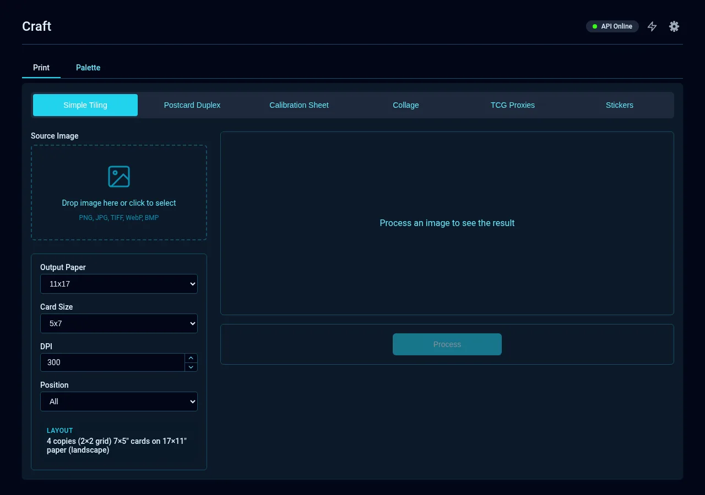

# Craft

Craft is two small tools behind one build: **print** (`/craft`) and **palette**
(`/craft/palette`). Open either one directly, or switch between them from the
header; nothing to sign into, nothing to install.

Print turns one image, or a pool of them, into a sheet ready to print: tiled,
duplexed for postcards, auto-packed as a collage, laid out as trading-card
proxies, or prepared as die-cut stickers. Palette turns an image into a set of
colours you can copy or export, picked by hand or found automatically.

- [Features](features.md): what each mode does and how to drive it.
- [Contributing](contributing.md): running it locally, the architecture, the
  checks it must pass.
- [History](history.md): a rename, an absorbed sibling app, and a proxy mode
  that outgrew one card game.
- [Trivia](trivia.md)

## Trivia

The palette route was once its own small repo; Craft absorbed it whole,
ColorThief CDN script and all, and rewrote the colour-finding to not need a
CDN at all ([history](history.md#the-rebrand)).
